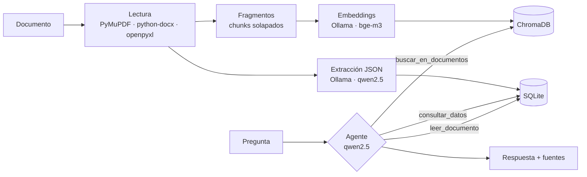

# 💬 DocuChat

**Chatea con tus documentos usando IA 100 % local.** Añade facturas, tickets, extractos, Excel o
notas y pregúntale cosas como:

- *«¿Cuánto pagué en la factura de la luz de marzo?»*
- *«¿Qué día compré el portátil y cuánto me costó?»*
- *«¿Cuánto he facturado en total en 2024?»*
- *«Resúmeme el contrato de alquiler»*

Todo se ejecuta en tu ordenador con [Ollama](https://ollama.com): **tus documentos nunca salen de tu PC**
y, una vez descargados los modelos, funciona sin internet.

---

## ✨ Características

- **Aplicación de escritorio** (PySide6 / Qt) para Windows, macOS y Linux.
- **Arrastrar y soltar** archivos o carpetas enteras: PDF, Word, Excel, CSV, TXT/MD e imágenes (con OCR opcional).
- **RAG (Retrieval-Augmented Generation)** con embeddings locales y ChromaDB.
- **Búsqueda filtrada por archivo**: entiende «en el archivo tal» aunque escribas el nombre aproximado.
- **Extracción de datos estructurados**: al añadir un documento, el modelo extrae fecha, emisor, receptor,
  importes y líneas de detalle, y los guarda en SQLite.
- **Agente con herramientas (tool calling)**: el modelo decide si buscar texto, hacer una consulta SQL
  (para sumas y totales) o leer un documento entero.
- **Consultas SQL seguras**: solo lectura, el modelo no puede modificar ni borrar nada.
- **Respuestas con fuentes**: indica de qué archivo y página sale cada dato.
- **Descarga guiada de modelos** la primera vez que se abre.

## 🧠 Cómo funciona



¿Por qué dos bases de datos? La búsqueda semántica (RAG) es muy buena para encontrar *texto*, pero
mala para *calcular*: no puede sumar 30 facturas. Por eso, además del índice vectorial, se extraen
los datos clave a SQLite y el agente puede hacer consultas como
`SELECT SUM(importe_total) FROM documentos WHERE strftime('%Y', fecha) = '2024'`.

## 🚀 Instalación

### 1. Requisitos
- **Python 3.10 – 3.12** → https://www.python.org (en Windows marca *«Add Python to PATH»*).
- **Ollama** → https://ollama.com (instálalo y déjalo abierto).
- Unos **8 GB de RAM** para el modelo por defecto (con menos, usa `qwen2.5:3b`).

### 2. Instalar la aplicación
**Windows:** doble clic en `instalar_windows.bat`.

**macOS / Linux:**
```bash
./instalar_mac_linux.sh
```

<details>
<summary>Instalación manual</summary>

```bash
python -m venv .venv
# Windows: .venv\Scripts\activate    ·    macOS/Linux: source .venv/bin/activate
pip install -r requirements.txt
python main.py
```
</details>

### 3. Abrir
**Windows:** `iniciar_windows.bat` · **macOS / Linux:** `./iniciar_mac_linux.sh`

La primera vez la app comprobará si tienes los modelos y te ofrecerá descargarlos
(también puedes hacerlo a mano):
```bash
ollama pull qwen2.5:7b    # modelo de chat (~4,7 GB)
ollama pull bge-m3        # modelo de embeddings multilingüe (~1,2 GB)
```

## ⚙️ Ajustes

Desde **⚙ Ajustes** puedes cambiar:

| Ajuste | Para qué sirve |
|---|---|
| Modelo de chat | `qwen2.5:7b` por defecto. Debe soportar *tool calling*: `qwen2.5`, `llama3.1`, `mistral-nemo`… Con modelos sin herramientas la app usa RAG clásico automáticamente. |
| Modelo de embeddings | `bge-m3` (muy bueno en español). Al cambiarlo, los documentos se reindexan solos. |
| Tu nombre / empresa | Permite distinguir lo que **has facturado** (eres el emisor) de lo que **has pagado** (eres el receptor). |
| Extraer datos | Desactívalo si solo usas documentos de texto y quieres que la carga sea más rápida. |

Los datos se guardan en la carpeta `~/.docuchat` (`C:\Users\<tú>\.docuchat` en Windows).
Puedes cambiarla con la variable de entorno `DOCUCHAT_DATA`.

### OCR (opcional) para PDFs escaneados e imágenes
1. Instala Tesseract: [Windows](https://github.com/UB-Mannheim/tesseract/wiki) · macOS `brew install tesseract tesseract-lang` · Linux `sudo apt install tesseract-ocr tesseract-ocr-spa`
2. `pip install pytesseract`

## 📁 Estructura del proyecto

```
docuchat/
├── main.py                 # Punto de entrada
├── app/
│   ├── config.py           # Rutas y ajustes
│   ├── loaders.py          # Lectura de PDF, Word, Excel, CSV, TXT, imágenes
│   ├── chunker.py          # División del texto en fragmentos
│   ├── llm.py              # Cliente de Ollama (chat, embeddings, descargas)
│   ├── vector_store.py     # Índice vectorial (ChromaDB)
│   ├── database.py         # SQLite: documentos, datos extraídos, consultas de solo lectura
│   ├── extractor.py        # Extracción estructurada (JSON schema) + normalización
│   ├── ingest.py           # Proceso completo de añadir un documento
│   ├── agent.py            # Agente con herramientas
│   ├── core.py             # Une todas las piezas
│   └── ui/                 # Interfaz PySide6 (ventana, diálogos, hilos, estilos)
└── tests/                  # Pruebas (pytest)
```

## 🧪 Pruebas

```bash
pip install pytest
python -m pytest tests
```

## 📦 Crear un ejecutable (opcional)

```bash
pip install pyinstaller
pyinstaller --name DocuChat --windowed --collect-all chromadb main.py
```
El ejecutable queda en `dist/DocuChat`. Cada usuario sigue necesitando Ollama instalado.

## ⚠️ Limitaciones conocidas

- La calidad depende del modelo: los modelos pequeños (3B) pueden equivocarse al extraer importes.
  Revisa los datos con **Ver datos** y usa **Volver a extraer datos** si algo no cuadra.
- De cada documento se envían al extractor unos 12.000 caracteres; en documentos muy largos
  (extractos de muchos meses) puede que no se extraigan todas las líneas. El chat sigue pudiendo
  buscar en todo el texto.
- La primera respuesta tarda más mientras Ollama carga el modelo en memoria.

## 🗺️ Ideas para seguir mejorando

- Respuestas en *streaming* (palabra a palabra).
- Gráficos de gastos por mes/categoría.
- Categorización automática de gastos.
- Vigilar una carpeta y añadir documentos nuevos automáticamente.
- Historial de conversaciones guardado.

## 🛠️ Tecnologías

Python · PySide6 · Ollama · ChromaDB · SQLite · PyMuPDF · python-docx · openpyxl
